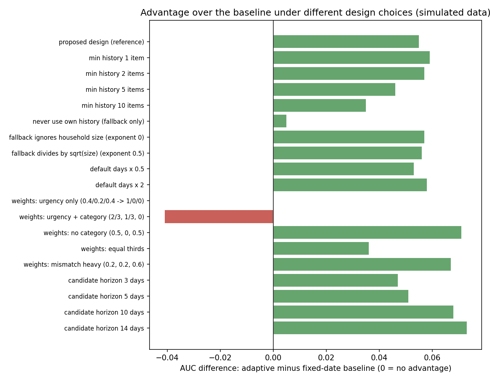
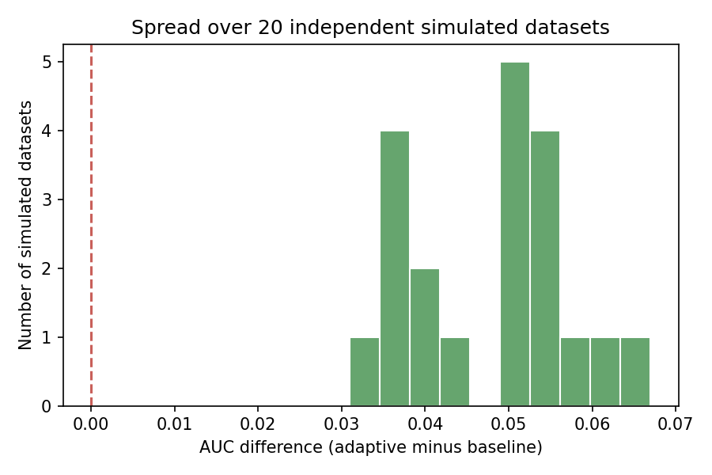

# Evaluation results: adaptive waste-risk score versus fixed-date baseline

> **These results come from simulated households.** They are a system check. They show how the two approaches behave on identical, controlled data. They are NOT evidence that the approach reduces food waste in real homes. The rules that generated the data are listed in `evaluation/simulate.py` and in `docs/EVALUATION_PROTOCOL.md`.

Data source: `data/simulated_items.csv`

## 1. Data

| households | items | used | wasted | unknown (excluded) | share wasted among confirmed |
|---|---|---|---|---|---|
| 40 | 11908 | 10287 | 852 | 769 | 7.6% |

## 2. Main comparison

Review day = one household on one day. Candidate items expire within 7 days. The baseline flags items within 3 days of expiry. The adaptive approach is given the same number of alerts on each day. Review days used for AUC: 2664. Days with alerts: 4210 (10367 alerts per approach).

| measure | baseline | adaptive | difference (adaptive - baseline) | 95% interval for difference |
|---|---|---|---|---|
| Ranking AUC (primary) | 0.667 | 0.722 | 0.055 | 0.037 to 0.076 |
| Precision of alerts (matched volume) | 0.250 | 0.268 | 0.018 | 0.012 to 0.024 |
| Recall of later-wasted items | 0.651 | 0.698 |  |  |
| False alarms (alerts on items later used) | 7780 | 7592 |  |  |
| Missed waste (later-wasted items not flagged) | 1388 | 1200 |  |  |

Intervals come from resampling whole households 1000 times. If an interval for a difference includes zero, the data do not show a reliable difference.

## 3. Sensitivity to design choices

One choice is changed at a time. The 'proposed design' row is the reference.

**Settings were fixed before this evaluation was run.** The weights (0.4 / 0.2 / 0.4), the default days per category, the 3-item history threshold and the 3-day baseline lead time were chosen at design time. The other rows show what would have happened under different choices. They are reported for transparency, not used to pick settings. Changing a setting after seeing these numbers would be a post-hoc change and must be declared as one.

'n/a' means every candidate item was already inside the baseline's lead time, so both approaches flag the same items and there is nothing to compare.

| variant | horizon (days) | baseline AUC | adaptive AUC | AUC difference | baseline precision | adaptive precision | precision difference |
|---|---|---|---|---|---|---|---|
| proposed design (reference) | 7 | 0.667 | 0.722 | 0.055 | 0.250 | 0.268 | 0.018 |
| min history 1 item | 7 | 0.667 | 0.726 | 0.059 | 0.250 | 0.268 | 0.019 |
| min history 2 items | 7 | 0.667 | 0.725 | 0.057 | 0.250 | 0.268 | 0.019 |
| min history 5 items | 7 | 0.667 | 0.714 | 0.046 | 0.250 | 0.265 | 0.016 |
| min history 10 items | 7 | 0.667 | 0.703 | 0.035 | 0.250 | 0.262 | 0.013 |
| never use own history (fallback only) | 7 | 0.667 | 0.672 | 0.005 | 0.250 | 0.253 | 0.004 |
| fallback ignores household size (exponent 0) | 7 | 0.667 | 0.724 | 0.057 | 0.250 | 0.268 | 0.018 |
| fallback divides by sqrt(size) (exponent 0.5) | 7 | 0.667 | 0.723 | 0.056 | 0.250 | 0.268 | 0.018 |
| default days x 0.5 | 7 | 0.667 | 0.721 | 0.053 | 0.250 | 0.266 | 0.017 |
| default days x 2 | 7 | 0.667 | 0.725 | 0.058 | 0.250 | 0.268 | 0.019 |
| weights: urgency only (0.4/0.2/0.4 -> 1/0/0) | 7 | 0.667 | 0.667 | 0.000 | 0.250 | 0.250 | 0.000 |
| weights: urgency + category (2/3, 1/3, 0) | 7 | 0.667 | 0.626 | -0.041 | 0.250 | 0.242 | -0.008 |
| weights: no category (0.5, 0, 0.5) | 7 | 0.667 | 0.738 | 0.071 | 0.250 | 0.271 | 0.021 |
| weights: equal thirds | 7 | 0.667 | 0.704 | 0.036 | 0.250 | 0.262 | 0.013 |
| weights: mismatch heavy (0.2, 0.2, 0.6) | 7 | 0.667 | 0.735 | 0.067 | 0.250 | 0.273 | 0.024 |
| candidate horizon 3 days | 3 | 0.604 | 0.650 | 0.047 | n/a | n/a | n/a |
| candidate horizon 5 days | 5 | 0.644 | 0.695 | 0.051 | 0.249 | 0.263 | 0.014 |
| candidate horizon 10 days | 10 | 0.668 | 0.736 | 0.068 | 0.253 | 0.272 | 0.019 |
| candidate horizon 14 days | 14 | 0.636 | 0.709 | 0.073 | 0.254 | 0.272 | 0.018 |

### Baseline lead time

The baseline's 3-day lead time is a pre-specified design choice, not a measured optimum. The table shows how the comparison changes if the lead time (and therefore the alert volume) changes.

| baseline lead time (days) | alert days | alerts per approach | baseline precision | adaptive precision | precision difference | baseline recall | adaptive recall |
|---|---|---|---|---|---|---|---|
| 1 | 2646 | 3896 | 0.369 | 0.375 | 0.006 | 0.465 | 0.473 |
| 2 | 3702 | 6988 | 0.299 | 0.315 | 0.016 | 0.555 | 0.584 |
| 3 | 4210 | 10367 | 0.250 | 0.268 | 0.018 | 0.651 | 0.698 |
| 5 | 3531 | 14050 | 0.189 | 0.196 | 0.008 | 0.834 | 0.868 |
| 7 | 0 | 0 | n/a | n/a | n/a | n/a | n/a |

## 4. Household size and the cold-start fallback

| household size | households | baseline AUC | adaptive AUC (proposed) | difference | adaptive AUC, fallback only, divides by size | adaptive AUC, fallback only, ignores size |
|---|---|---|---|---|---|---|
| 1 person | 8 | 0.650 | 0.681 | 0.031 | 0.652 | 0.652 |
| 2 people | 14 | 0.684 | 0.724 | 0.040 | 0.693 | 0.699 |
| 3 people | 5 | 0.652 | 0.759 | 0.106 | 0.638 | 0.697 |
| 4 or more | 13 | 0.665 | 0.755 | 0.090 | 0.672 | 0.708 |

The last two columns use no household history at all, so they isolate the fallback rule. Compare 'divides by size' with 'ignores size' within each group.

## 5. Early days versus later days

| period | review days | baseline AUC | adaptive AUC (proposed) | difference | adaptive AUC, fallback only |
|---|---|---|---|---|---|
| first 30 days of a household's data | 350 | 0.657 | 0.667 | 0.011 | 0.658 |
| days 30 to 59 | 429 | 0.694 | 0.719 | 0.025 | 0.677 |
| day 60 onwards | 1885 | 0.663 | 0.733 | 0.070 | 0.674 |

If learning from a household's own history helps, the adaptive score should improve relative to the 'fallback only' column in later periods.

## 6. Repeated on 20 independently simulated datasets

AUC difference (adaptive minus baseline): mean 0.048, standard deviation 0.010, range 0.031 to 0.067; adaptive was higher in 20 of 20 datasets. Mean precision difference: 0.015.

| seed | baseline AUC | adaptive AUC | AUC difference | baseline precision | adaptive precision | precision difference |
|---|---|---|---|---|---|---|
| 1 | 0.667 | 0.722 | 0.055 | 0.250 | 0.268 | 0.018 |
| 2 | 0.664 | 0.700 | 0.036 | 0.230 | 0.240 | 0.010 |
| 3 | 0.691 | 0.722 | 0.031 | 0.246 | 0.257 | 0.012 |
| 4 | 0.670 | 0.720 | 0.051 | 0.287 | 0.299 | 0.013 |
| 5 | 0.657 | 0.709 | 0.052 | 0.267 | 0.283 | 0.016 |
| 6 | 0.663 | 0.714 | 0.051 | 0.270 | 0.286 | 0.016 |
| 7 | 0.649 | 0.716 | 0.067 | 0.273 | 0.293 | 0.021 |
| 8 | 0.664 | 0.719 | 0.055 | 0.283 | 0.301 | 0.017 |
| 9 | 0.648 | 0.688 | 0.041 | 0.313 | 0.329 | 0.017 |
| 10 | 0.660 | 0.710 | 0.050 | 0.277 | 0.294 | 0.017 |
| 11 | 0.667 | 0.721 | 0.054 | 0.294 | 0.313 | 0.019 |
| 12 | 0.687 | 0.724 | 0.037 | 0.258 | 0.271 | 0.014 |
| 13 | 0.674 | 0.731 | 0.057 | 0.256 | 0.271 | 0.015 |
| 14 | 0.661 | 0.704 | 0.043 | 0.242 | 0.257 | 0.015 |
| 15 | 0.664 | 0.701 | 0.037 | 0.266 | 0.279 | 0.013 |
| 16 | 0.674 | 0.737 | 0.063 | 0.268 | 0.287 | 0.019 |
| 17 | 0.663 | 0.718 | 0.054 | 0.285 | 0.302 | 0.017 |
| 18 | 0.665 | 0.716 | 0.051 | 0.246 | 0.260 | 0.014 |
| 19 | 0.672 | 0.712 | 0.040 | 0.303 | 0.317 | 0.014 |
| 20 | 0.688 | 0.724 | 0.036 | 0.263 | 0.274 | 0.011 |

## Checks that the evaluation itself is sound

`python3 evaluation/test_evaluation.py` runs 12 checks, including: history used for a score contains only outcomes dated strictly before the review day; changing a future outcome does not change an earlier score; an urgency-only score reproduces the baseline exactly; and a **label-shuffle test**, in which outcomes are assigned at random and both approaches must fall to chance (about 0.5). If the adaptive score still beat chance there, information from the future would be leaking in.

## How to read these results honestly

- **Circularity.** The score is evaluated only with information available on each day, and the simulator does not use the score. Even so, simulated outcomes are produced by rules chosen by the author, so a good result shows the method works under those rules, not in the real world.
- **Unknown outcomes** are excluded. Real households may leave many items unconfirmed, which could bias any real-data result.
- **Price totals** are the value of items recorded as used or thrown away. They are not savings.
- **Repeated days.** The same item can appear on several review days. That is why intervals come from resampling whole households.

## Figures

